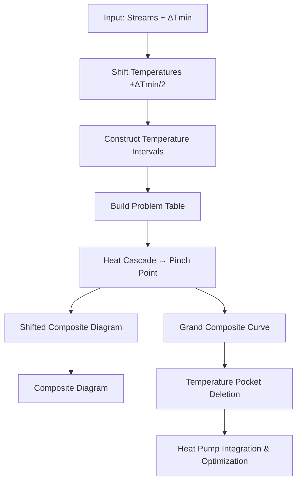

# Pinch Analysis

Pinch Analysis is the foundational calculation of HeatTransPlan. It determines the **minimum heating and cooling utility** requirements for a set of process streams, identifies the **Pinch Temperature**, and constructs the diagnostic curves (Composite Curves, Grand Composite Curve) that drive all downstream modules.

The implementation follows the classic methodology from Linnhoff & Hindmarsh (1983), extended to handle edge cases in multi-process industrial settings. The core lives in {code}`backend/app/modules/pinch/pinch.py#Pinch`.

---

## Pipeline Summary

When the stream selection on the Potential Analysis page changes, the browser sends the selected streams and $\Delta T_{min}$ to the `/api/analysis/pinch` endpoint, which runs these steps in sequence:



Steps B to H run in {code}`backend/app/services/analysis_service.py#run_pinch`. The heat pump steps rebuild the same analysis with {code}`backend/app/modules/pinch_main.py#PinchMain.solve_pinch_for_hpi`, then delete the temperature pockets (Step 8) and hand the result on — see [Heat Pump Integration](heat_pump_integration.md) and [Heat Pump Optimization](heat_pump_optimization.md).

**Implementation:** {code}`backend/app/services/analysis_service.py#run_pinch`

<details>
<summary><b>Show the code</b></summary>

```{literalinclude} ../backend/app/services/analysis_service.py
:language: python
:pyobject: run_pinch
```

</details>

---

## Input: Process Streams

Every stream is defined by three numbers:

| Parameter | Symbol | Unit | Meaning |
|-----------|--------|------|---------|
| Heat capacity flow rate | $\dot{C}_P$ | kW/°C | Mass flow × specific heat capacity |
| Supply temperature | $T_S$ | °C | Temperature the stream starts at |
| Target temperature | $T_T$ | °C | Temperature the stream must reach |

The browser derives them from what was entered in data collection: $\dot{C}_P$ directly if it was given, otherwise mass flow × specific heat, with units converted to °C, kg/s, kJ/(kg·K) and kW/K first ({code}`frontend/src/utils/streamUtils.ts#getStreamInfo`).

A stream is classified automatically:

- **Hot stream**: $T_S > T_T$ — the stream needs to be cooled (releases heat).
- **Cold stream**: $T_S < T_T$ — the stream needs to be heated (absorbs heat).

The user also supplies a **minimum approach temperature** $\Delta T_{min}$, which is the smallest allowed temperature difference between a hot and a cold stream at any point of heat exchange.

**Implementation:** {code}`backend/app/modules/pinch/streams.py#Streams.create_streams`

<details>
<summary><b>Show the code</b></summary>

```{literalinclude} ../backend/app/modules/pinch/streams.py
:language: python
:pyobject: Streams.create_streams
```

</details>

---

## Step 1 — Shift Temperatures by ΔTmin/2

To guarantee that the minimum approach temperature $\Delta T_{min}$ is respected between hot and cold streams, we **shift** all stream temperatures before constructing any interval diagram:

$$
T_{shifted}^{hot} = T_{actual} - \frac{\Delta T_{min}}{2}
$$

$$
T_{shifted}^{cold} = T_{actual} + \frac{\Delta T_{min}}{2}
$$

**Why this works:** After shifting, whenever a hot and cold stream share the same shifted temperature, their actual temperatures are exactly $\Delta T_{min}$ apart. This guarantees feasible heat exchange without checking every pair.

Both supply and target temperatures of each stream are shifted:

- A hot stream at 200°C → 150°C with $\Delta T_{min} = 10$°C becomes 195°C → 145°C.
- A cold stream at 50°C → 120°C becomes 55°C → 125°C.

**Implementation:** {code}`backend/app/modules/pinch/pinch.py#Pinch.shift_temperatures`

<details>
<summary><b>Show the code</b></summary>

```{literalinclude} ../backend/app/modules/pinch/pinch.py
:language: python
:pyobject: Pinch.shift_temperatures
```

</details>

---

## Step 2 — Construct Temperature Intervals

All unique shifted temperatures are collected and sorted in descending order. The gaps between consecutive temperatures form the **temperature intervals**.

For each interval $[T_i, T_{i+1}]$, we record which streams pass through it:

- A hot stream passes through the interval if its shifted supply temperature ≥ $T_i$ **and** its shifted target temperature ≤ $T_{i+1}$.
- A cold stream passes through if its shifted target temperature ≥ $T_i$ **and** its shifted supply temperature ≤ $T_{i+1}$.

**Implementation:** {code}`backend/app/modules/pinch/pinch.py#Pinch.construct_temperature_interval`

<details>
<summary><b>Show the code</b></summary>

```{literalinclude} ../backend/app/modules/pinch/pinch.py
:language: python
:pyobject: Pinch.construct_temperature_interval
```

</details>

---

## Step 3 — Build the Problem Table

For each temperature interval, we compute:

1. **Temperature span**: $\Delta T_i = T_i - T_{i+1}$
2. **Net heat capacity**: $\Delta \dot{C}_{P,i} = \sum \dot{C}_{P}^{hot} - \sum \dot{C}_{P}^{cold}$ (summed over streams active in that interval)
3. **Enthalpy change**: $\Delta H_i = \Delta T_i \times \Delta \dot{C}_{P,i}$

The sign convention is:

- $\Delta H_i > 0$: the interval has a **net surplus** of heat (hot streams dominate).
- $\Delta H_i < 0$: the interval has a **net deficit** (cold streams dominate).

**Implementation:** {code}`backend/app/modules/pinch/pinch.py#Pinch.construct_problem_table`

<details>
<summary><b>Show the code</b></summary>

```{literalinclude} ../backend/app/modules/pinch/pinch.py
:language: python
:pyobject: Pinch.construct_problem_table
```

</details>

---

## Step 4 — Heat Cascade and Pinch Point

The heat cascade is constructed in two passes:

### Pass 1: Unfeasible Cascade (no external utility)

Starting from the top (hottest interval), we cascade heat downward by accumulating $\Delta H$ values:

$$
\dot{Q}_{exit,i} = \dot{Q}_{exit,i-1} + \Delta H_i
$$

starting with $\dot{Q}_{exit,0} = 0$ (no utility). If any $\dot{Q}_{exit,i}$ goes negative, the cascade is **infeasible** — there is not enough heat available from above.

### Pass 2: Feasible Cascade

The minimum hot utility required is:

$$
\dot{Q}_{H,min} = -\min(\dot{Q}_{exit,i}^{unfeasible})
$$

We re-run the cascade starting with $\dot{Q}_{exit,0} = \dot{Q}_{H,min}$ instead of zero. Now all exit enthalpies are ≥ 0.

### Key results

| Result | Formula | Physical meaning |
|--------|---------|-----------------|
| **Pinch temperature** | $T_{pinch}$ = bottom of the interval where $\dot{Q}_{exit} = 0$ | Temperature where zero heat crosses — divides the problem into above-pinch (needs heating) and below-pinch (needs cooling) |
| **Minimum hot utility** | $\dot{Q}_{H,min}$ | External heating required (above the pinch) |
| **Minimum cold utility** | $\dot{Q}_{C,min}$ = final $\dot{Q}_{exit}$ | External cooling required (below the pinch) |

The pinch temperature is reported as a **shifted** temperature: the hot streams sit $\Delta T_{min}/2$ above it, the cold streams $\Delta T_{min}/2$ below.

```{note}
These results are checked against a worked textbook problem in {code}`backend/tests/test_golden.py#test_textbook_four_stream_problem`: two hot and two cold streams at $\Delta T_{min} = 10$ K, solved by hand in the test — 20 kW hot utility, 60 kW cold utility, pinch at 85 °C shifted (90 °C hot / 80 °C cold). The full chain from pinch to optimization is pinned against golden values in the same file.
```

**Implementation:** {code}`backend/app/modules/pinch/pinch.py#Pinch.construct_heat_cascade`

<details>
<summary><b>Show the code</b></summary>

```{literalinclude} ../backend/app/modules/pinch/pinch.py
:language: python
:pyobject: Pinch.construct_heat_cascade
```

</details>

---

## Step 5 — Shifted Composite Diagram

The **Shifted Composite Diagram** plots the cumulative enthalpy of all hot streams and all cold streams separately, using shifted temperatures. Each composite curve is a piecewise-linear function $T$ vs. $H$.

### Construction

For each temperature interval, the total enthalpy released by hot streams and absorbed by cold streams is:

$$
\Delta H_i^{hot} = \sum_{j \in hot} \dot{C}_{P,j} \times (T_i - T_{i+1})
$$

$$
\Delta H_i^{cold} = \sum_{j \in cold} \dot{C}_{P,j} \times (T_i - T_{i+1})
$$

The **hot composite** is built by accumulating $\Delta H^{hot}$ from the cold end upward (starting at $H = 0$).

The **cold composite** is built by accumulating from the hot end downward, starting at the total cold enthalpy plus the cold utility.

After construction, flat segments at the ends (where no streams are active) are trimmed off to produce clean curves.

**Implementation:** {code}`backend/app/modules/pinch/pinch.py#Pinch.construct_shifted_composite_diagram`

<details>
<summary><b>Show the code</b></summary>

```{literalinclude} ../backend/app/modules/pinch/pinch.py
:language: python
:pyobject: Pinch.construct_shifted_composite_diagram
```

</details>

---

## Step 6 — Composite Diagram (Actual Temperatures)

The Composite Diagram is obtained by **un-shifting** the temperatures from the Shifted Composite Diagram:

$$
T_{actual}^{hot} = T_{shifted}^{hot} + \frac{\Delta T_{min}}{2}
$$

$$
T_{actual}^{cold} = T_{shifted}^{cold} - \frac{\Delta T_{min}}{2}
$$

The enthalpy values ($H$) remain the same — only the temperature axis changes. At the pinch, the **vertical** gap between the two curves — a temperature difference — equals exactly $\Delta T_{min}$.

**Implementation:** {code}`backend/app/modules/pinch/pinch.py#Pinch.construct_composite_diagram`

<details>
<summary><b>Show the code</b></summary>

```{literalinclude} ../backend/app/modules/pinch/pinch.py
:language: python
:pyobject: Pinch.construct_composite_diagram
```

</details>

---

## Step 7 — Grand Composite Curve (GCC)

The Grand Composite Curve plots the **net heat surplus** at each shifted temperature level. It is constructed directly from the feasible heat cascade:

$$
GCC(T_i) = \dot{Q}_{exit,i}
$$

where $T_i$ are the shifted temperature interval boundaries and $\dot{Q}_{exit,i}$ are the feasible cascade exit enthalpies computed in Step 4.

The GCC starts at $(\dot{Q}_{H,min},\ T_{max})$ at the top and ends at $(\dot{Q}_{C,min},\ T_{min})$ at the bottom. It touches zero at the **pinch temperature** — this is the defining property of the pinch.

In the app, the GCC is the input for:

- **Temperature pocket deletion** (Step 8), which turns it into the source and sink profiles of the default *with heat recovery* mode;
- **Heat pump integration and optimization**, drawn behind both heat pump charts for reference.

**Implementation:** {code}`backend/app/modules/pinch/pinch.py#Pinch.construct_grand_composite_curve`

<details>
<summary><b>Show the code</b></summary>

```{literalinclude} ../backend/app/modules/pinch/pinch.py
:language: python
:pyobject: Pinch.construct_grand_composite_curve
```

</details>

---

## Step 8 — Temperature Pocket Deletion

The Grand Composite Curve (GCC) can contain **temperature pockets** — regions where the curve doubles back on itself, creating a local surplus sandwiched between deficits (or vice versa). These pockets represent heat that can be exchanged internally within the process and do **not** need external utility.

Before using the GCC for heat pump integration, these pockets are removed to obtain the **pocket-free GCC**, showing only the truly external utility requirement. This runs only in the default *with heat recovery* mode; the *no heat recovery* mode uses the composite curves instead (see [Heat Pump Integration](heat_pump_integration.md#source-and-sink-profiles--heat-recovery-modes)).

### Deletion Algorithm

The algorithm works on the heat cascade in two passes: one from the pinch **downward**, and one from the top of the curve **down to the pinch**, so pockets are removed on both sides. Each pass eliminates a pocket by **linear interpolation**. Three cases arise when an interval is followed by one of the opposite sign — below the pinch, a surplus ($\Delta H > 0$) followed by a deficit ($\Delta H < 0$):

1. **Deficit smaller than surplus:** The deficit interval is fully absorbed by interpolating on the surplus interval's temperature range:
   $$T_{new} = T_{i} + \frac{T_{i} - T_{i+1}}{H_{exit,i} - H_{exit,i+1}} \times H_{exit,i+2}$$

2. **Surplus smaller than deficit:** The surplus interval is fully absorbed by interpolating on the deficit interval:
   $$T_{new} = T_{i+2} + \frac{T_{i+1} - T_{i+2}}{H_{exit,i+1} - H_{exit,i+2}} \times (H_{exit,i} - H_{exit,i+2})$$

3. **Equal magnitude:** Both intervals cancel exactly and the intermediate temperature point is removed.

The same three cases are handled when an interval with no net heat ($\Delta H = 0$) sits between the surplus and the deficit. After every deletion the pass starts over — from the pinch, or from the top — until no pocket is left.

**Implementation:** {code}`backend/app/modules/utility/temperature_pocket_deletion.py#TemperaturePocketDeletion.delete_temperature_pockets`, called from {code}`backend/app/modules/heat_pump_integration/heat_pump_integration.py#HeatPumpIntegration.delete_temperature_pockets`

<details>
<summary><b>Show the code</b></summary>

```{literalinclude} ../backend/app/modules/utility/temperature_pocket_deletion.py
:language: python
:pyobject: TemperaturePocketDeletion.delete_temperature_pockets
```

</details>

---

## Status Quo Comparison

The table *Comparison of Status Quo and Proposal* on the Potential Analysis page sets the pinch targets against what the site uses today. The user enters the current heating and cooling supply; the savings are the difference to the pinch minimum:

$$
\text{Savings}_{heat} = \dot{Q}_{H,current} - \dot{Q}_{H,min} \qquad
\text{Savings}_{cool} = \dot{Q}_{C,current} - \dot{Q}_{C,min}
$$

each also given as a percentage of the current supply.

The heat pump columns show how much of the remaining demand a heat pump would cover:

$$
\text{Coverage}_{heat} = \min(\dot{Q}_{sink},\ \dot{Q}_{H,min}) \qquad
\text{Coverage}_{cool} = \min(\dot{Q}_{source},\ \dot{Q}_{C,min})
$$

The pump is the one boxed on the [optimization chart](heat_pump_optimization.md#how-the-results-are-shown) — the pump picked there, if one was clicked — with $\dot{Q}_{source} = \dot{Q}_{sink}\,(COP - 1)/COP$. The page and the report use the same rule, so they always name the same machine.

**Implementation:** {code}`backend/app/services/analysis_service.py#run_status_quo` (savings), {code}`frontend/src/components/analysis/hpRules.ts#highlightedPumpOf` (the pump, on the page), {code}`backend/app/services/report_service.py#_hp_view` (the pump, in the report)

<details>
<summary><b>Show the code</b></summary>

```{literalinclude} ../backend/app/services/analysis_service.py
:language: python
:pyobject: run_status_quo
```

</details>
